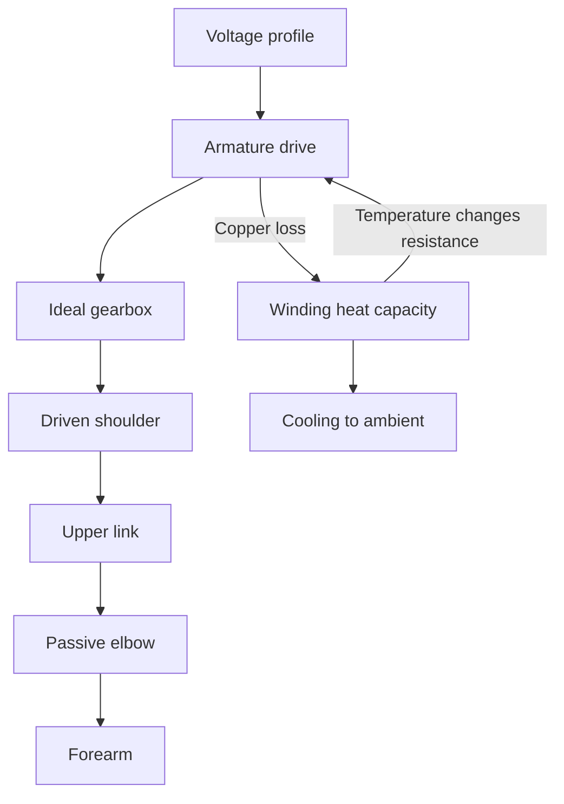

# Native multiphysics experiments

## The systems

| Model | Native run | Verification |
| --- | --- | --- |
| `MotorizedPendulum3D` | 0–4 s; 400 intervals; tolerance 1e-6 | Initial conditions and command; independent pendulum torque balance and armature voltage balance |
| `HeatedBody` | 0–5 s; 500 intervals; tolerance 1e-7 | Every output temperature against the delayed exponential solution |
| MSL `DoublePendulum` | 0–1 s; 200 intervals; tolerance 1e-6 | Both joint angles/velocities finite and moving; completion time. This is a baseline smoke check. |
| `ThermalGearedArm3D` | 0–8 s; 800 intervals; tolerance 1e-7 | Voltage profile, temperature-dependent resistance, copper loss, heat balance, gearbox kinematics/torque/power, rigid link lengths and spatial motion |

The solver uses its own internal timesteps; the interval counts specify output sampling. Event timestamps may appear more than once. The exporter and viewer preserve those native samples.

## The coupled arm

The shoulder rotates about Z. The elbow rotates about the first link's X axis, so the second link can leave the shoulder's plane. Both are genuine `MultiBody.Revolute` joints connected to physical `BodyBox` components with mass and inertia. The upper link is 0.55 m and the lower link is 0.45 m.



The electrical circuit is the existing `ArmatureDrive`. `ThermalArmatureDrive` inherits it and enables the MSL resistor's thermal port. A heat capacity stores the resistor's loss; a thermal conductor removes heat to a fixed ambient. Resistance depends on that winding temperature. These couplings are native connector equations.

The applied voltage ramps from 0 to 6 V between 0.5 and 1 s, remains at 6 V until 3 s, then ramps to zero by 3.5 s. Zero voltage leaves the armature circuit closed, so motion can still generate current and copper heating. The arm is an open-loop experiment, not a position-controlled robot. The ideal motor omits rotor/housing spatial inertia, iron loss and saturation; the gearbox is lossless. Joint damping dissipates mechanical energy separately and is not routed into the winding.

## Reproduce the native pipeline

The CI container pins OpenModelica 1.27.1 by image digest and includes OMPython. The workflow requests MSL 4.1.0 through OpenModelica's package manager; its maintenance source revision is not locked. The install log records the revision actually used.

Run at the repository root with `omc` and OMPython available:

```sh
omc scripts/install_msl.mos
omc scripts/native_smoke.mos
python3 scripts/export_native_csv.py m0_motorized_pendulum m0_thermal_step m0_msl_double_pendulum m1_thermal_geared_arm
python3 scripts/verify_csv.py
python3 scripts/test_native_scene.py
python3 scripts/build_preview.py
```

The native script removes only this suite's previous result/scene files before simulating. A failed rerun cannot pass by finding an old CSV or MAT file. CI runs in a fresh workspace and preserves each run's artifact independently.

The native simulation emits MAT results and visualization XML. OpenModelica's ordinary CSV writer omits parameters, including some geometry dimensions. `export_native_csv.py` reads complete values through OpenModelica's own result API and writes CSV including those parameters and signed aliases. It performs no simulation or parameter evaluation. The MAT remains in the artifact as the primary native result.

## What the numerical checks establish

The pendulum oracle uses its independently specified nominal mass, inertia, gravity, damping and motor parameters. It checks Newton–Euler torque balance and the electrical loop across the trajectory. The thermal oracle checks all samples against the exponential response to the delayed heating step.

The coupled arm checks the electrical and thermal balances, ideal gear constraints, link lengths and connector continuity. A separate trapezoidal integration of net winding heating checks stored thermal energy. These checks catch sign, coupling, parameter and output errors; they do not independently solve the full spatial mechanism or validate an actual physical motor against measurements.

Representative evidence from the first successful coupled-arm run ([44277708474](https://github.com/physicsvigilante/domelica_lab/actions/runs/44277708474)):

- Native initialization and simulation succeeded for all four models.
- The arm tip's Z-coordinate range was approximately 0.302 m.
- The winding rose from 293.15 K to a peak of approximately 294.043 K.
- Independent checks on that downloaded result found maximum voltage/heat/gear-power residuals below 1e-12 in their respective units, and integrated winding-energy error about 0.000455 J on the 0.01 s output grid.

Those numbers are experiment results for the nominal parameters, not general specifications of a real motor.

## Browser checks and visual scope

The workflow's browser job opens the generated HTML in Chromium and exercises scene switching, Play/Pause/Replay, scrubbing, camera controls, object inspection, synchronized values, offline operation and a 390 px mobile layout. It checks framing across every exported shape pose and preserves screenshots plus a report tied to the HTML's SHA-256. A passing native job alone does not imply a passing browser job.

The viewer supports a defined native primitive subset and displays three mechanical scenes through the same exporter and renderer. The thermal-only experiment is numerically verified; the coupled arm's actual winding trace is shown in the browser.

Actual **OMEdit GUI animation has not been inspected** in this project. To do so, open `DomelicaLab/package.mo`, select the desired example and choose **Simulate with Animation**. Native OpenModelica results and the browser renderer are separate deliverables. CAD assets, arbitrary visualizers and a general in-browser model editor remain future work.
